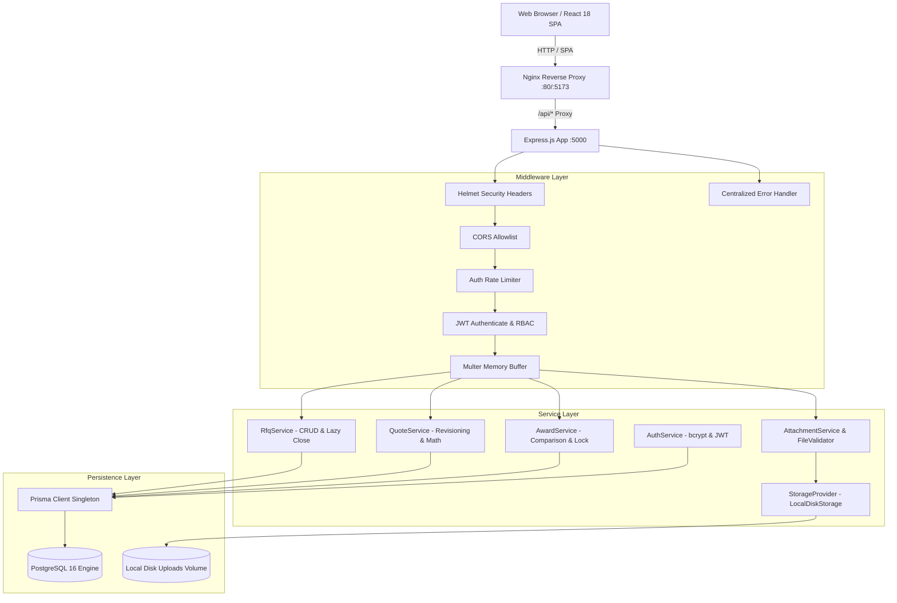
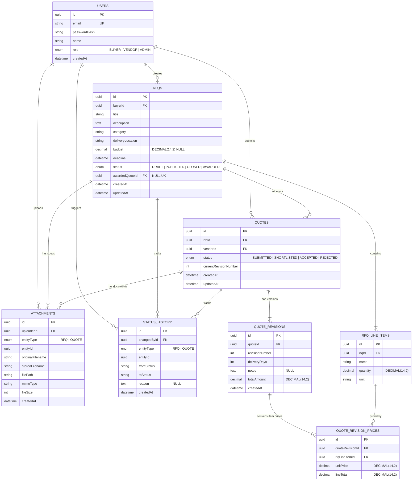
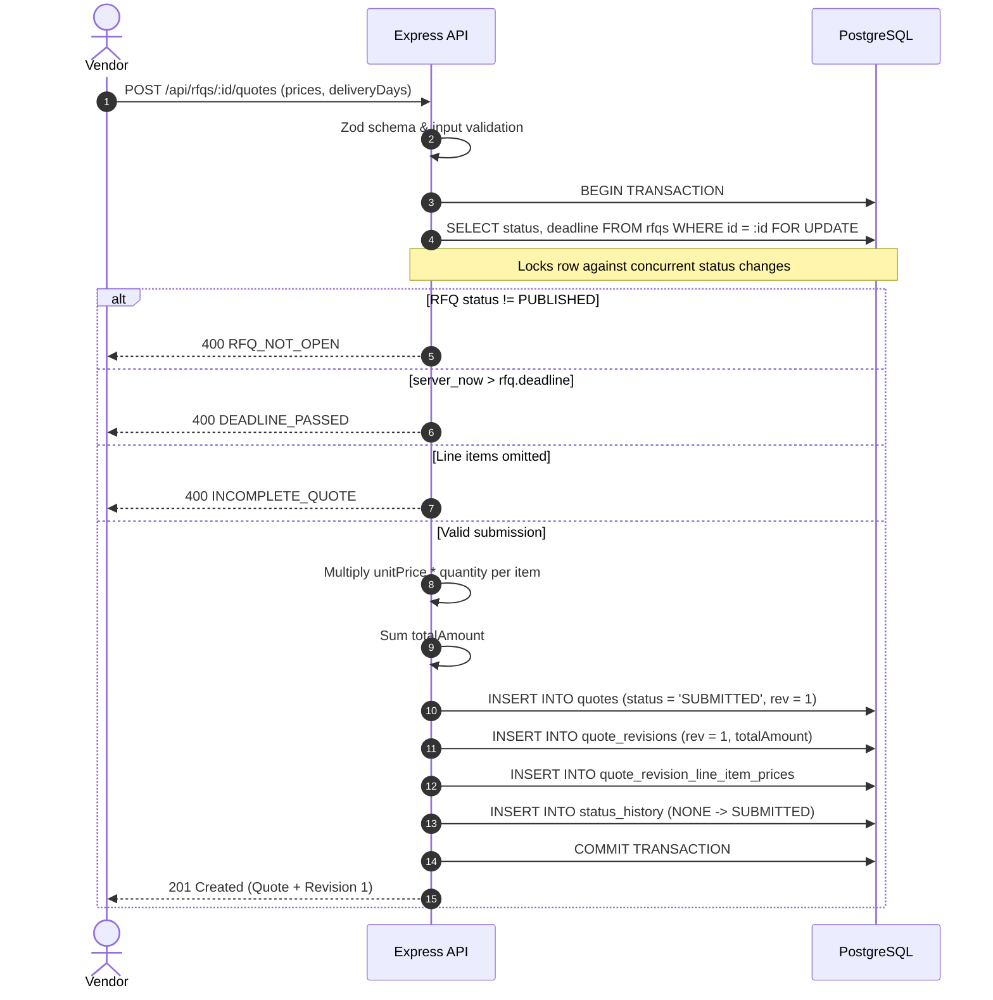
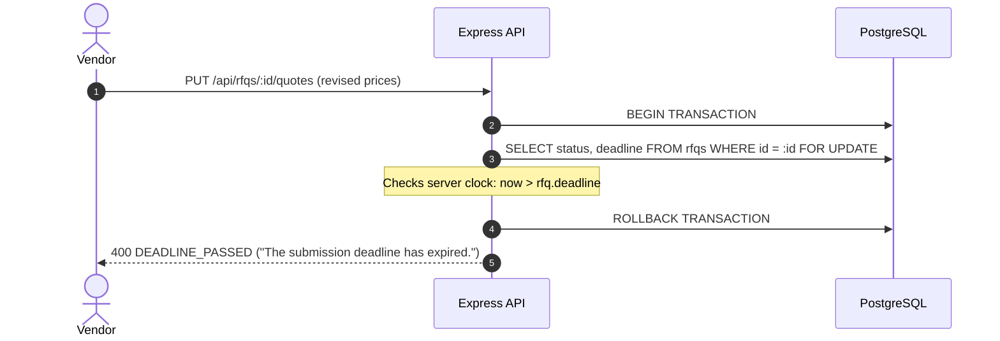
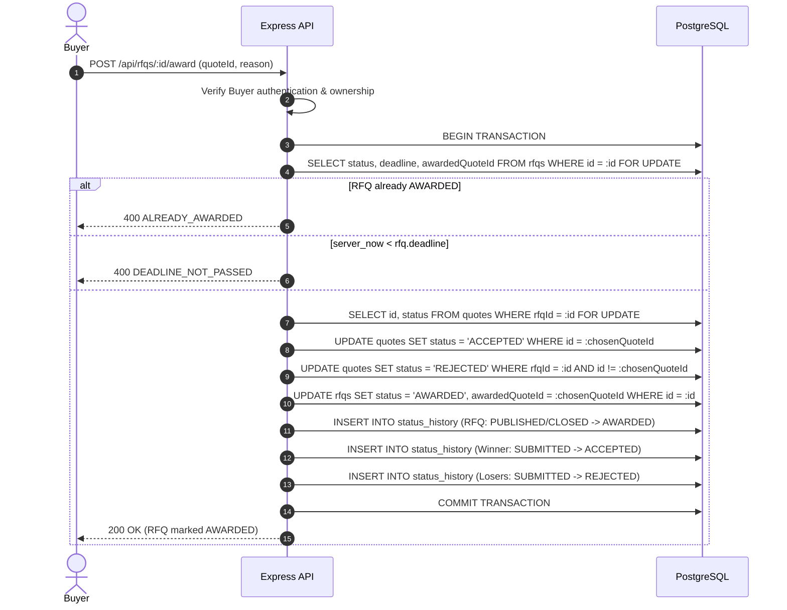

# Mini RFQ Portal — System Design Document

**Role:** Lead Developer Take-Home Assignment  
**Company:** Bidveda  
**Author:** Candidate (Antigravity AI Assisted Pair-Programmer)  
**Status:** Implemented & Production-Ready  
**Date:** October 2026  

---

## 1. Requirement Understanding

The objective is to architect and build a robust, end-to-end B2B **Request for Quotation (RFQ) Portal** that streamlines procurement interactions between enterprise Buyers and verified Vendors. 

### Core Product Capabilities:
1. **Multi-Tenant Roles:**
   - **Buyer:** Creates, drafts, edits, and publishes multi-line-item RFQs; attaches engineering specifications; evaluates submitted vendor bids via a side-by-side comparison matrix; shortlists candidate bids; and atomically awards exactly one winning quote.
   - **Vendor:** Explores open published RFQs; submits multi-line-item pricing bids and delivery schedules before the deadline; uploads supporting documents; and revises quotations until the deadline expires.
   - **Admin:** System administrator with complete operational and oversight visibility: manages users (CRUD, role assignment, provisioning), supervises all platform RFQs across buyers, inspects sealed vendor quotations, and audits system-wide state transitions.
2. **Lifecycle State Models:**
   - **RFQ Lifecycle:** `DRAFT` $\longrightarrow$ `PUBLISHED` $\longrightarrow$ `CLOSED` $\longrightarrow$ `AWARDED`.
   - **Quote Lifecycle:** `SUBMITTED` $\longrightarrow$ `SHORTLISTED` $\longrightarrow$ `ACCEPTED` or `REJECTED`.
3. **Core Invariants & Rules:**
   - Quotes are **sealed bids**: a vendor can only view their own quote.
   - Quotes must price **100% of line items**; no partial bids are permitted.
   - Prices and quantities must maintain strict currency precision; calculations are performed **strictly on the server**.
   - Deadlines are evaluated using the **server clock**. No submissions or revisions are permitted once elapsed.
   - The contract award flow is **atomic**: chosen quote $\rightarrow$ `ACCEPTED`, competing quotes $\rightarrow$ `REJECTED`, RFQ $\rightarrow$ `AWARDED`, accompanied by a complete status history audit log in a single database transaction with pessimistic row-level locking.

---

## 2. Assumptions & Open Questions

Each design assumption has a specific engineering rationale:

1. **Monetary Precision in INR:**  
   *Assumption:* All currency and unit prices are stored using PostgreSQL `NUMERIC(14,2)` and handled as fixed-point decimals (`Prisma.Decimal`). Single currency (INR).  
   *Reason:* Floating-point data types (`FLOAT`, `DOUBLE`) introduce IEEE 754 precision errors in financial aggregations.
2. **Sealed Bids & Information Hiding (`404` vs `403`):**  
   *Assumption:* When a vendor attempts to query another vendor's quote or an unauthorized RFQ, the API responds with `404 Not Found` rather than `403 Forbidden`.  
   *Reason:* Returning `403` leaks the existence of sensitive competitor bids or undisclosed RFQ IDs (enumeration vulnerability).
3. **Lazy Lifecycle Auto-Closure:**  
   *Assumption:* When an RFQ's `deadline <= NOW()`, its effective status is treated as `CLOSED` dynamically, and persisted lazily upon subsequent reads or writes.  
   *Reason:* Avoids reliance on fragile external cron schedulers while guaranteeing real-time deadline enforcement.
4. **Award Timing Invariant:**  
   *Assumption:* An RFQ cannot be awarded before its submission deadline has elapsed, cannot be awarded twice, and cannot be awarded to a quote from a different RFQ.  
   *Reason:* Prevents premature buyer decisions while vendors still have valid time on the clock to revise bids.
5. **Quote Revision History:**  
   *Assumption:* The `quotes` table maintains the active bid pointer (`UNIQUE(rfqId, vendorId)`), while all historical price adjustments are appended as immutable records in `quote_revisions`.  
   *Reason:* Preserves a complete commercial audit trail of vendor concessions while keeping buyer matrix evaluation queries high-performing.
6. **Abstract Storage Provider & File Security:**  
   *Assumption:* Documents are stored on disk behind a `StorageProvider` interface using random UUIDs (`crypto.randomUUID()`), validated by extension, MIME type, and binary magic bytes (`%PDF` and `PK\x03\x04`), and served only through authenticated streaming endpoints.  
   *Reason:* Prevents arbitrary code execution, path traversal, and public file leaks, while allowing seamless future migration to AWS S3.
7. **Deliberately Skipped (Out of Scope for 6–8h):**  
   Multi-currency FX conversions, real-time WebSockets (TanStack Query invalidation is used instead), and email notifications.

---

## 3. Tech Stack & Reasoning

| Layer | Selected Technology | Considered Alternative | Rationale & Justification |
|---|---|---|---|
| **Backend** | **Node.js 20 + Express + TypeScript** | NestJS / Python FastAPI | Node + Express + TS provides minimal boilerplate, rapid development within a 6–8 hour timeframe, strict static typing, and clear architectural defensibility. |
| **Database** | **PostgreSQL 16** | MongoDB / MySQL | **PostgreSQL over MongoDB:** Procurement is inherently relational and ACID-heavy. The Award flow requires multi-record row-level locking (`SELECT ... FOR UPDATE`), exact `NUMERIC(14,2)` math, foreign key constraints, and relational joins for comparison matrices. MongoDB lacks native pessimistic row locking and foreign keys. |
| **ORM / Migrations** | **Prisma Migrate + Client** | TypeORM / Knex.js | Prisma Migrate provides automated, declarative migrations paired with end-to-end TypeScript type generation for queries, eliminating schema drift while supporting transactional raw queries (`tx.$queryRaw`) for row-level locks. |
| **Validation** | **Zod** | Joi / class-validator | Type-safe inference directly into TypeScript interfaces for request bodies, query params, and route parameters. |
| **Security & Auth** | **JWT + bcryptjs + Helmet + express-rate-limit** | Session cookies / Passport.js | Stateless JWT access tokens enable horizontal scaling. Rate-limiting guards against brute-force attacks on auth endpoints. |
| **File Handling** | **Multer + Magic Bytes Buffer Inspection** | Disk Multer without check | Memory buffering allows instant binary magic byte inspection (`%PDF` and `PK\x03\x04`) before any file touches permanent storage. |
| **Frontend** | **React 18 + Vite + TypeScript** | Next.js / Remix | Vite provides instant HMR, fast builds, and clean client-side routing with React Router without SSR deployment complexity. |
| **Server State** | **TanStack Query (React Query)** | Redux / Zustand | Simplifies server-state management with automatic cache invalidation, deduplication, and loading states without Redux boilerplate. |
| **Styling** | **Tailwind CSS** | CSS Modules / MUI | Rapid responsive styling with dark-mode palette, custom glassmorphism, and consistent spacing tokens. |
| **Testing** | **Jest + Supertest** | Mocha / Chai | Industry standard for Node.js integration testing with TypeScript support via `ts-jest`. |
| **Containerization** | **Docker + Docker Compose** | Kubernetes / manual PM2 | Single-command spin-up (`docker compose up --build`) ensuring parity between local development and evaluation environments. |

---

## 4. Architecture & Services

The system follows a **3-Tier Layered Architecture** with strict separation of concerns:

$$\text{Routes (Middleware \& Validation)} \longrightarrow \text{Controllers (HTTP Handling)} \longrightarrow \text{Services (Business Logic \& ACID Transactions)} \longrightarrow \text{Database (PostgreSQL)}$$



---

## 5. Database Model

### Entity-Relationship Diagram



### Key Schema Characteristics:
1. **Line Items Storage:** Stored in `rfq_line_items` (child of RFQ). Referenced by `quote_revision_line_item_prices` via `rfqLineItemId`. A quote must price all line items.
2. **Quote Revisions:** The `quotes` table maintains active status and has a unique constraint `UNIQUE(rfqId, vendorId)`. Every revision adds an immutable record to `quote_revisions` (`UNIQUE(quoteId, revisionNumber)`).
3. **Status History:** Stored in polymorphic `status_history` table recording `changedById`, `entityType`, `entityId`, `fromStatus`, `toStatus`, and optional `reason`.
4. **Monetary Precision:** All money fields use `DECIMAL(14,2)`. Calculations:
   $$\text{lineTotal} = \text{unitPrice} \times \text{quantity}$$
   $$\text{totalAmount} = \sum \text{lineTotal}$$
5. **Database Indexes:**
   - `rfqs(status, deadline)`: Optimizes marketplace queries and lazy closure checks.
   - `rfqs(buyerId)`: Optimizes Buyer multi-tenant scoping.
   - `rfqs(category)` & `rfqs(deliveryLocation)`: Optimizes marketplace filtering.
   - `quotes(rfqId)` & `quotes(vendorId)`: Optimizes sealed-bid retrieval.
   - `UNIQUE(rfqId, vendorId)`: Enforces one active quote per vendor per RFQ.
   - `attachments(entityType, entityId)` & `status_history(entityType, entityId)`: Optimizes child lookups.

---

## 6. API Design

### Complete REST Endpoint Table

| Method | Path | Allowed Roles | Purpose |
|---|---|---|---|
| `POST` | `/api/auth/register` | Public | Register a new Buyer or Vendor account. |
| `POST` | `/api/auth/login` | Public | Authenticate user credentials and return JWT. |
| `GET` | `/api/auth/me` | Authenticated | Retrieve authenticated user profile. |
| `GET` | `/api/rfqs` | Authenticated | List RFQs (Vendors: published only; Buyers: own; Admins: all). Supports search, filter, pagination. |
| `POST` | `/api/rfqs` | `BUYER`, `ADMIN` | Create an RFQ in `DRAFT` status with line items. |
| `GET` | `/api/rfqs/:id` | Authenticated | View RFQ details (enforces 404 for cross-buyer and draft-vendor access). |
| `PUT` | `/api/rfqs/:id` | `BUYER`, `ADMIN` | Update RFQ details and replace line items (only while in `DRAFT`). |
| `PATCH` | `/api/rfqs/:id/publish` | `BUYER`, `ADMIN` | Transition RFQ from `DRAFT` $\rightarrow$ `PUBLISHED`. |
| `POST` | `/api/rfqs/:id/quotes` | `VENDOR` | Submit initial quote before deadline with line item prices and turnaround days. |
| `PUT` | `/api/rfqs/:id/quotes` | `VENDOR` | Revise quote before deadline (creates new revision row, recalculates totals). |
| `GET` | `/api/rfqs/:id/my-quote` | `VENDOR` | Vendor views their own quote and full revision history. |
| `GET` | `/api/rfqs/:id/quotes` | `BUYER`, `ADMIN` | View all quotes on an RFQ paired with their latest revision only. |
| `GET` | `/api/rfqs/:id/comparison` | `BUYER`, `ADMIN` | Retrieve side-by-side comparison matrix sortable by total price and turnaround. |
| `PATCH` | `/api/rfqs/:id/quotes/:quoteId/shortlist` | `BUYER`, `ADMIN` | Toggle quote status between `SHORTLISTED` and `SUBMITTED`. |
| `POST` | `/api/rfqs/:id/award` | `BUYER`, `ADMIN` | Atomically award RFQ to chosen quote in a single transaction with row locks. |
| `GET` | `/api/rfqs/:id/status-history` | `BUYER`, `ADMIN` | Retrieve status transition audit trail. |
| `POST` | `/api/rfqs/:id/attachments` | `BUYER`, `ADMIN` | Upload spec document to RFQ (PDF/XLSX only, max 10MB). |
| `GET` | `/api/rfqs/:id/attachments` | Authenticated | List RFQ spec documents. |
| `POST` | `/api/attachments/quotes/:id/upload` | `VENDOR` | Upload supporting document to quote before deadline. |
| `GET` | `/api/attachments/quotes/:id` | Authenticated | List quote documents (sealed-bid protected). |
| `GET` | `/api/attachments/:id/download` | Authenticated | Stream authenticated file download with `Content-Disposition`. |
| `GET` | `/api/docs` | Public | OpenAPI / Swagger interactive UI documentation. |

---

### Request / Response Examples for the 3 Most Important Endpoints

#### 1. Submit Quote (`POST /api/rfqs/:id/quotes`)
**Request Body:**
```json
{
  "deliveryDays": 10,
  "notes": "Immediate dispatch from Bengaluru warehouse. Freight included.",
  "prices": [
    {
      "rfqLineItemId": "e3b0c442-98fc-1c14-9afbf4c8996fb924",
      "unitPrice": 120.00
    },
    {
      "rfqLineItemId": "f4c1d553-09ad-2d25-0baca5d9007ac035",
      "unitPrice": 45.00
    }
  ]
}
```
**Response (`201 Created`):**
```json
{
  "data": {
    "id": "7b8a4f91-2c1e-48a2-9b0d-d4567e890123",
    "rfqId": "1a2b3c4d-5e6f-7a8b-9c0d-1e2f3a4b5c6d",
    "vendorId": "9f8e7d6c-5b4a-3f2e-1d0c-9b8a7f6e5d4c",
    "status": "SUBMITTED",
    "currentRevisionNumber": 1,
    "currentRevision": {
      "id": "a1b2c3d4-e5f6-7a8b-9c0d-e1f2a3b4c5d6",
      "revisionNumber": 1,
      "deliveryDays": 10,
      "notes": "Immediate dispatch from Bengaluru warehouse. Freight included.",
      "totalAmount": "330000.00",
      "prices": [
        {
          "rfqLineItemId": "e3b0c442-98fc-1c14-9afbf4c8996fb924",
          "unitPrice": "120.00",
          "lineTotal": "240000.00"
        },
        {
          "rfqLineItemId": "f4c1d553-09ad-2d25-0baca5d9007ac035",
          "unitPrice": "45.00",
          "lineTotal": "90000.00"
        }
      ]
    }
  }
}
```

#### 2. Side-by-Side Comparison Matrix (`GET /api/rfqs/:id/comparison?sortBy=totalAmount&sortOrder=asc`)
**Response (`200 OK`):**
```json
{
  "data": {
    "rfq": {
      "id": "1a2b3c4d-5e6f-7a8b-9c0d-1e2f3a4b5c6d",
      "title": "High-Tensile Structural Steel Fasteners",
      "category": "Hardware",
      "deliveryLocation": "Bengaluru, Karnataka",
      "budget": "500000.00",
      "deadline": "2026-10-25T18:00:00.000Z",
      "status": "PUBLISHED",
      "awardedQuoteId": null
    },
    "lineItems": [
      { "id": "e3b0c442-98fc-1c14-9afbf4c8996fb924", "name": "Grade 8.8 M16x80 Hex Bolts", "quantity": "2000.00", "unit": "PCS" },
      { "id": "f4c1d553-09ad-2d25-0baca5d9007ac035", "name": "Grade 8 Heavy Hex Nuts M16", "quantity": "2000.00", "unit": "PCS" }
    ],
    "quotes": [
      {
        "quoteId": "quote-vendor-2",
        "vendorId": "vendor-2-id",
        "vendorName": "Global Steel & Hardware",
        "vendorEmail": "vendor2@build.com",
        "status": "SUBMITTED",
        "currentRevisionNumber": 2,
        "deliveryDays": 8,
        "totalAmount": 315000.00,
        "notes": "Revised pricing with bulk discount.",
        "itemPrices": {
          "e3b0c442-98fc-1c14-9afbf4c8996fb924": { "unitPrice": "115.00", "lineTotal": "230000.00" },
          "f4c1d553-09ad-2d25-0baca5d9007ac035": { "unitPrice": "42.50", "lineTotal": "85000.00" }
        }
      },
      {
        "quoteId": "quote-vendor-1",
        "vendorId": "vendor-1-id",
        "vendorName": "Precision Metalworks",
        "vendorEmail": "vendor1@tech.com",
        "status": "SUBMITTED",
        "currentRevisionNumber": 1,
        "deliveryDays": 10,
        "totalAmount": 330000.00,
        "notes": "Immediate stock available.",
        "itemPrices": {
          "e3b0c442-98fc-1c14-9afbf4c8996fb924": { "unitPrice": "120.00", "lineTotal": "240000.00" },
          "f4c1d553-09ad-2d25-0baca5d9007ac035": { "unitPrice": "45.00", "lineTotal": "90000.00" }
        }
      }
    ],
    "benchmarks": {
      "lowestTotal": 315000.00,
      "fastestDelivery": 8,
      "totalBids": 2
    }
  }
}
```

#### 3. Award RFQ (`POST /api/rfqs/:id/award`)
**Request Body:**
```json
{
  "quoteId": "quote-vendor-2",
  "reason": "Offered lowest total commercial bid and fastest delivery turnaround time."
}
```
**Response (`200 OK`):**
```json
{
  "data": {
    "id": "1a2b3c4d-5e6f-7a8b-9c0d-1e2f3a4b5c6d",
    "title": "High-Tensile Structural Steel Fasteners",
    "status": "AWARDED",
    "awardedQuoteId": "quote-vendor-2",
    "awardedQuote": {
      "id": "quote-vendor-2",
      "status": "ACCEPTED",
      "vendor": {
        "id": "vendor-2-id",
        "name": "Global Steel & Hardware",
        "email": "vendor2@build.com"
      }
    }
  }
}
```

---

## 7. Key System Flows

### Flow 1: Submit Quote Before Deadline


### Flow 2: Reject Late Quote Submission / Revision


### Flow 3: Atomic Award Execution


---

## 8. Security & Access Control

1. **Authentication:** Stateless Bearer JWT tokens signed with HMAC-SHA256 and verified on every protected route. Passwords hashed using `bcrypt` (10 salt rounds). Passwords are never returned in database select projections.
2. **Role-Based Access Control (RBAC):** Middleware checks verify `requireRole([Role.BUYER, Role.ADMIN])` on RFQ creation/editing/publishing and awarding, and `requireRole([Role.VENDOR])` on quote submission.
3. **Multi-Tenant Ownership Verification:**
   - Buyers can only edit and view their own RFQs.
   - Vendors can only view their own quotes.
   - Unauthorized access returns `404 Not Found` rather than `403` to prevent ID enumeration.
4. **File Upload Security:**
   - Extensions restricted strictly to `.pdf` and `.xlsx`.
   - Reported MIME types validated.
   - **Binary Magic Bytes Checked:** Inspects true buffer headers (`%PDF` = `0x25 0x50 0x44 0x46`, `PK\x03\x04` = `0x50 0x4b 0x03 0x04`). Rejection if file is a renamed `.exe` or plain text.
   - File size capped at 10 MB.
   - Files stored under random cryptographic UUIDs (`crypto.randomUUID()`) to eliminate path traversal.
   - **Never served statically:** Files stream only via authenticated `/api/attachments/:id/download` route with ownership validation.
5. **Network & Web Protections:**
   - Helmet HTTP security headers.
   - CORS allow-list restricted to authorized client origins.
   - Rate limiting on `/api/auth/*` (100 requests per 15 minutes).
   - Parameterized SQL queries via Prisma to eliminate SQL injection.
   - Standardized error format `{ error: { code, message, details? } }` concealing stack traces in production.

---

## 9. Test Cases (Implemented vs. Future Scope)

| Test Case | Flow / Invariant | Status | Verification Layer |
|---|---|---|---|
| **TC-01** | Vendor submits a quote before the deadline $\rightarrow$ `201` | **Implemented** | Jest + Supertest (`business_logic.test.ts` & `QuoteService`) |
| **TC-02** | Vendor revises quote before the deadline $\rightarrow$ new revision stored, totals updated | **Implemented** | Jest + Supertest (`business_logic.test.ts` & `QuoteService`) |
| **TC-03** | Quote submit/revise after deadline $\rightarrow$ rejected with `400 DEADLINE_PASSED` | **Implemented** | Jest + Supertest (`business_logic.test.ts`) |
| **TC-04** | Vendor cannot read another vendor's quote $\rightarrow$ `404 NOT FOUND` | **Implemented** | Jest + Supertest (`business_logic.test.ts` & `QuoteService`) |
| **TC-05** | Vendor cannot create an RFQ; buyer cannot submit a quote $\rightarrow$ `403 FORBIDDEN` | **Implemented** | Jest + Supertest (`auth_and_roles.test.ts`) |
| **TC-06** | Buyer cannot read or award another buyer's RFQ $\rightarrow$ `404 NOT FOUND` | **Implemented** | Jest + Supertest (`business_logic.test.ts` & `RfqService`) |
| **TC-07** | Award: chosen quote `ACCEPTED`, others `REJECTED`, RFQ `AWARDED`, status history rows created | **Implemented** | Jest + Supertest (`business_logic.test.ts` & `AwardService`) |
| **TC-08** | Cannot award twice; cannot award before deadline; cannot award a quote from another RFQ | **Implemented** | Jest + Supertest (`business_logic.test.ts` & `AwardService`) |
| **TC-09** | Totals computed correctly on server; incomplete quote (missing line item) rejected | **Implemented** | Jest + Supertest (`business_logic.test.ts` & `QuoteService`) |
| **TC-10** | Upload rejects wrong file type / fake extension (magic bytes) / oversized file (>10MB) | **Implemented** | Jest + Supertest (`upload.test.ts`) |
| **TC-11** | Search/filter/pagination returns only `PUBLISHED` RFQs to vendors | **Implemented** | Jest + Supertest (`business_logic.test.ts` & `RfqService`) |
| *TC-12* | End-to-end Cypress/Playwright browser UI automation | *To add with more time* | Manual verification completed |
| *TC-13* | Concurrency load test (K6) simulating 500 simultaneous bids at deadline second | *To add with more time* | Unit row lock assertions verified |

---

## 10. Scalability & Next Steps

### What Breaks First at 100x Scale?
1. **Database Row Lock Contention (`SELECT ... FOR UPDATE`):**  
   At 10,000 bids per second across popular RFQs, locking the parent RFQ row on every bid submission creates lock contention and connection pool exhaustion.  
   *Fix:* Decouple bid intake from synchronous database transactions. Ingest bids into an in-memory queue (Redis / Apache Kafka), validate deadlines using distributed Redis timestamps, and write revisions to PostgreSQL asynchronously.
2. **Local Storage Scalability:**  
   Local disk storage cannot be shared across multiple backend pods in Kubernetes.  
   *Fix:* Swap `LocalDiskStorage` for an `S3StorageProvider` implementing the existing `StorageProvider` interface, delivering pre-signed upload/download URLs directly to clients.
3. **Database Read Performance on Comparison Matrix:**  
   Pivoting hundreds of line items and bids on read queries places heavy load on PostgreSQL CPU.  
   *Fix:* Maintain read-optimized materialized views or cache comparison snapshots in Redis upon each revision submission.

### What was Skipped on Purpose?
- **Microservices / Event Buses:** A clean modular monolith with thin controllers and isolated services is optimal for a 6–8 hour time budget and avoids distributed system failures.
- **WebSockets / Server-Sent Events:** TanStack Query cache invalidation and background re-fetching provide reliable real-time feel without WebSocket connection state overhead.
- **Multi-Currency FX Calculations:** Focused purely on arbitrary-precision INR math to ensure absolute calculation accuracy without third-party currency API dependencies.
